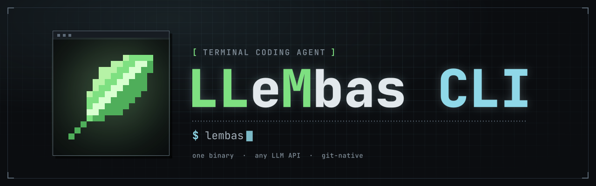

<p align="center">
  
</p>

# LLeMbas CLI

A terminal coding agent and project manager: the `lembas` command. It signs in to a
[LLeMbas](https://github.com/LLeMbas/LLeMbas) server and uses its models, memory and search, works
in your project with four permission modes and a git snapshot of every turn, keeps its own notes,
knowledge bases and skills on your machine, and lets the server's web UI work the same sessions.
Linux, x64 and arm64.

## Install

```sh
curl -fsSL https://github.com/LLeMbas/LLeMbas-CLI/releases/latest/download/get.sh | bash
```

Or download a binary from [Releases](https://github.com/LLeMbas/LLeMbas-CLI/releases). Every
release's `SHA256SUMS` is signed with the release key, and `get.sh` checks the signature and the
checksum before installing anything ([SECURITY.md](SECURITY.md) shows how to check by hand).

## First steps

```sh
lembas login https://your-server       # sign in to your LLeMbas server
cd your-project && lembas              # the TUI, on the server's models
```

From 2.0 the CLI talks only to the LLeMbas server it is logged in to; the custom connections of 1.x
(`dialect:` entries in `connections.yaml`) are gone.

`lembas` updates itself (`lembas update` does it now); `lembas uninstall` removes it, and
`--purge` takes settings and sessions too.

## Links

- Documentation: <https://llembas.eu/cli.html> and <https://llembas.eu/docs/>
- Changelog: <https://llembas.eu/changelog.html>
- The server: <https://github.com/LLeMbas/LLeMbas>

## Licence

MIT — see [LICENSE](LICENSE) and [THIRD_PARTY.md](THIRD_PARTY.md).
